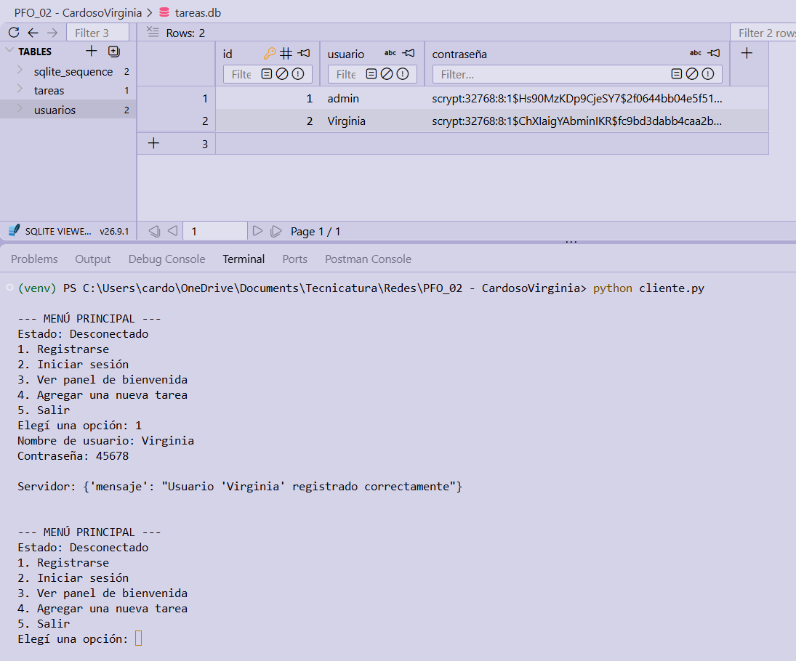
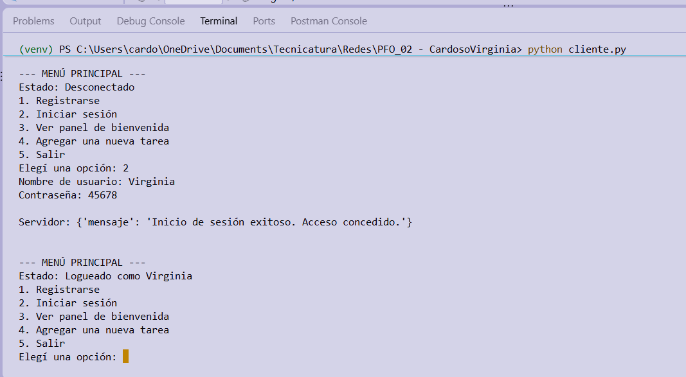
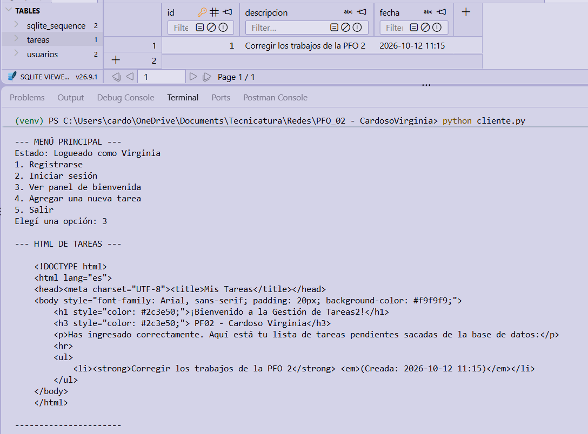
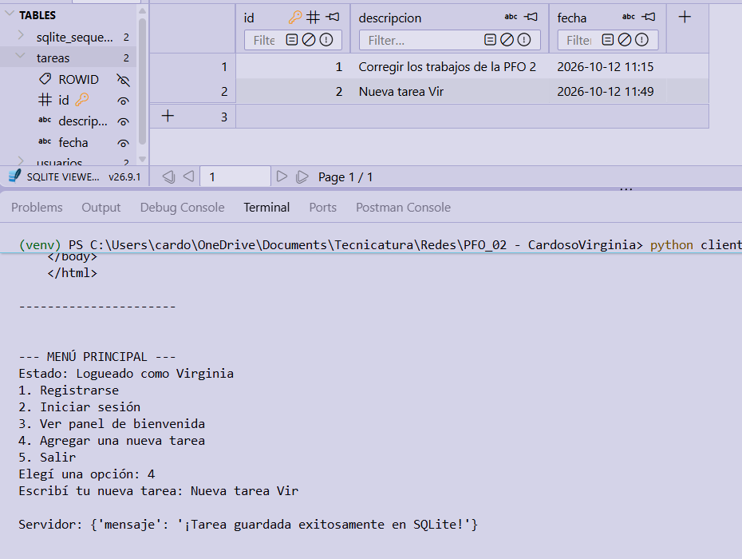

# Propuesta Formativa Obligatoria 2
## Sistema de Gestión de Tareas con API y Base de Datos

Este proyecto implementa una arquitectura Cliente-Servidor utilizando una API REST en Flask y una base de datos local en SQLite. Permite el registro seguro de usuarios, el inicio de sesión y la visualización/creación de tareas dinámicas.

---

### Características del Sistema
* **Seguridad:** Las contraseñas de los usuarios se almacenan hasheadas utilizando `werkzeug.security`.
* **Persistencia:** Toda la información (usuarios y tareas) se guarda de manera persistente en `tareas.db`. Al inicializar, el sistema crea automáticamente un usuario administrador y una tarea de prueba si no existen.
* **Control de Sesión en Consola:** El cliente interactivo valida localmente que el usuario haya iniciado sesión antes de permitirle ver el panel HTML de tareas o agregar nuevas.
* **Endpoints:** 
  * `POST /registro` y `POST /login` para autenticación.
  * `POST /nueva_tarea` para ingestar datos a la DB.
  * `GET /tareas` para devolver el HTML renderizado con la información de SQLite.

---

## Instrucciones de Ejecución

1. **Instalar las dependencias necesarias:**
   Abrí la terminal y ejecutá:
   `pip install flask werkzeug requests`

2. **Iniciar el Servidor (API):**
   En la terminal, ejecutá el siguiente comando para levantar el servidor y auto-generar la base de datos:
   `python servidor.py`

3. **Iniciar el Cliente:**
   Abriendo una segunda terminal en paralelo (sin cerrar el servidor), ejecutá:
   `python cliente.py`

4. **Probar el sistema:** 
   Utilizá el menú numérico en la terminal del cliente. Podés crear tu propio usuario o iniciar sesión con el usuario de prueba (`admin` / clave: `1234`).

---

## Respuestas Conceptuales

**1. ¿Por qué hashear contraseñas?**
Almacenar contraseñas en texto plano es una vulnerabilidad crítica. El hasheo (mediante herramientas como *scrypt* o *bcrypt*) transforma la contraseña en una cadena de caracteres irreversible. De esta forma, si la base de datos es comprometida o filtrada, los atacantes solo obtendrán hashes indescifrables, protegiendo así la identidad y privacidad de los usuarios en el sistema.

**2. Ventajas de usar SQLite en este proyecto:**
SQLite proporciona persistencia de datos con una extrema ligereza arquitectónica, ya que su motor está integrado en la librería estándar de Python. Al funcionar como un archivo local de proceso único (`tareas.db`), elimina la necesidad de instalar, configurar y mantener servicios de bases de datos externos (como MySQL o PostgreSQL). Esto facilita enormemente el desarrollo ágil, las pruebas locales y la portabilidad del código.

---

### Demostración funcionamiento

> Registro nuevo usuario con pesistencia en la base de manera segura por medio de un hash:

>  Validación e inicio de sesión correcto:

> Código de bienvenida con visualización de las tareas (html):

> Creación de nueva tarea y actualización de la db:

---
